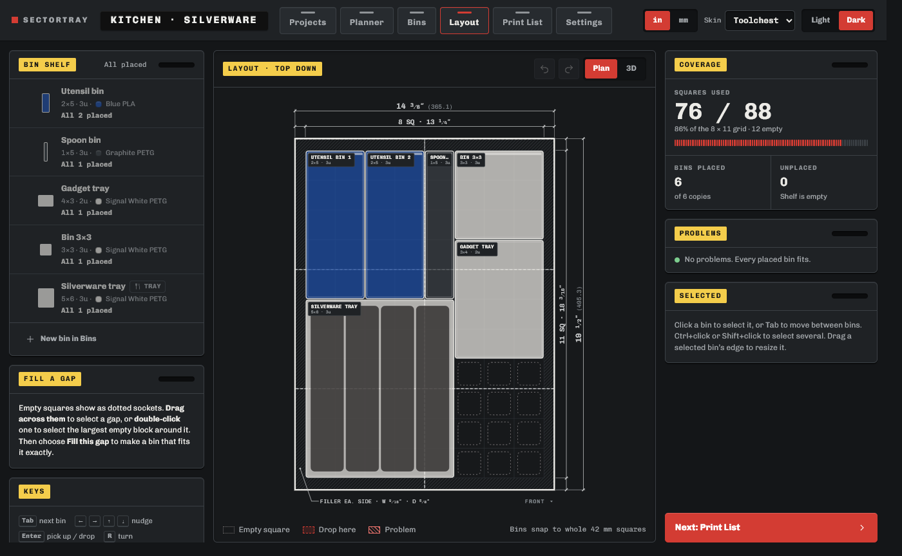

# SectorTray

Design 3D-printed [Gridfinity](https://gridfinity.xyz/) organizers for your drawers, offline and without CAD. Measure a drawer with a tape measure (inches with fractions, or millimeters!), and SectorTray fits the grid to it, splits the baseplate into pieces your 3D printer can handle, lets you lay out bins and trays, then sends the parts to your slicer.

It runs entirely on your PC. No account is needed, nothing is uploaded to any cloud, and there isn't any telemetry of any kind.

## Download and install (Windows only at this time)

1. Go to [Releases](https://github.com/celticviking/sectortray/releases) and download the newest **`SectorTray-<version>-setup.exe`**.
2. Run it. Windows may say "Windows protected your PC" because the app isn't code-signed: click **More info**, then **Run anyway**. (Getting code-signed is on the list.)
3. Start SectorTray from the Start menu or the desktop shortcut. The first time, it asks which printer you use.

It installs for your Windows account only and needs Windows 10 or 11, 64-bit. Windows 11 already has everything else. The window uses Microsoft's free WebView2 Runtime; if a Windows 10 PC doesn't have it, SectorTray offers to open in your web browser instead (or [get the runtime](https://developer.microsoft.com/microsoft-edge/webview2/)).

If you'd rather not install anything and instead grab the code and scan it, the release also has a **portable zip**: unzip it anywhere and double-click `SectorTray.exe` to launch.

**Your files:** drawers, settings and exported parts are saved in `Documents\SectorTray` by default. Settings → About → Saved drawers can move them somewhere else. Uninstalling SectorTray does *not* delete them.

**Updating:** download and run the newer setup file. SectorTray doesn't check for updates by itself (it never goes online and doing so is **not** a part of the roadmap), so watch the Releases page if you want to know about new versions.

## Your first drawer

The short version: measure the inside of the drawer → type it into the **Planner** → add bins on **Bins** (pro tip: name them something descriptive!) → arrange them on **Layout** → **Print List** → Export all → open in your slicer (note: I use PrusaSlicer and that's all I've had to test on - please submit an issue if it's not working correctly). I'd suggest printing one baseplate piece and one small bin first to check the fit.

The [first-drawer guide](guide/first-drawer.md) walks through it with pictures and explains the Gridfinity words (squares, u, filler, lip).

## Tab Functions

- **Planner:** fits the 42 mm Gridfinity grid to the drawer and splits the baseplate into pieces that fit your printer's bed. Or choose the new **Fit to drawer**, which resizes the squares as necessary so the grid fills the drawer with no filler strip, while adjusting the squares beneath the bins at the same time. It also shows the tallest bin that fits, and a 3D view.
- **Bins:** bins with compartments, label tabs, finger scoops, stacking lips, magnet or screw holes and half-size feet, with a live 3D preview in your filament colors. Select several bins to change them all at once; undo and redo.
- **Silverware trays:** measure your forks, knives and spoons and get a tray with tapered, head-to-tail slots. Trays too long for your printer print as two halves that clip together.
- **Layout:** drag bins onto the grid, turn them (R) so label tabs face any way, copy and paste, and fill an empty gap with a bin made to fit it exactly. Overlaps, overhangs and bins too tall for the drawer are flagged.
- **Print List:** every part with its status and filament, an estimate in grams, and **how many magnets and screws to buy if desired**. **Export all** saves the STL files; **Open in your slicer** sends one 3MF file with every part named and laid out on the bed. **Plates** groups the parts into bed loads; you can also tick parts and plates off as you print them to help keep track when you've got a lot.
- **Bins too big for your bed** can print in pieces that join with snap clips or bow-tie keys (keys are *experimental*; print the joint test in Settings first).
- **Share a drawer** with someone else who has SectorTray: Save as file on its card, and they use Open a drawer file.
- Three looks (Toolchest, Machinist, Drafting), each in light or dark. Text size can be made larger.

## Good to know

- **Windows only** for now; I'd like to get it onto other platforms as time and capacity allow.
- **Slicers:** PrusaSlicer is tested. Bambu Studio, OrcaSlicer and UltiMaker Cura are supported but untested; if parts land oddly there, use that slicer's Arrange.
- **Experimental:** snap clips have only been tested on a Prusa CORE One, and bow-tie keys for bins are theoretical for SectorTray builds (they've been used in other projects at other dimensions; I'll test them soon in SectorTray and update this in a future release).
- **Estimates** (grams) are approximate, usually a little high (on purpose).
- This is a personal project shared in case it's useful. [Issues](https://github.com/celticviking/sectortray/issues) are welcome (there are forms for bugs and ideas), but there's no promise of support or of when things get fixed.

## Build it yourself

See [BUILDING.md](BUILDING.md).

## Credits and license

SectorTray is free software under the [GNU GPL v3.0 or later](LICENSE).

Gridfinity is the open modular storage system created by [Zack Freedman](https://gridfinity.xyz/). SectorTray uses [Gridfinity Rebuilt in OpenSCAD](https://github.com/kennetek/gridfinity-rebuilt-openscad) by kennetek (MIT) for bins and baseplates, [Gridfinity Extended](https://github.com/ostat/gridfinity_extended_openscad) by ostat (GPL-3.0) for silverware trays, [OpenSCAD](https://openscad.org/) to make the 3D files and [three.js](https://threejs.org/) for the previews. The full list, with versions and licenses, is in [NOTICE.md](NOTICE.md).
