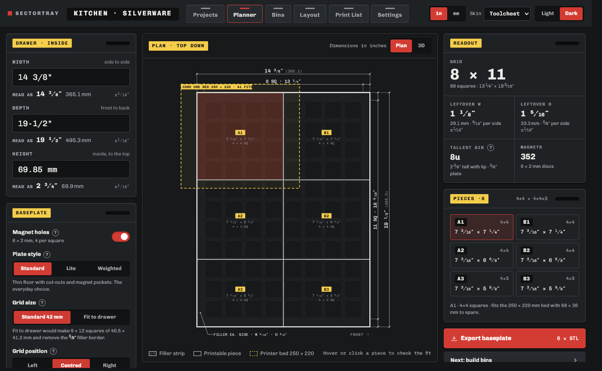
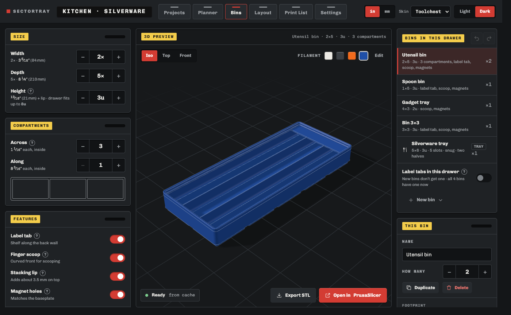
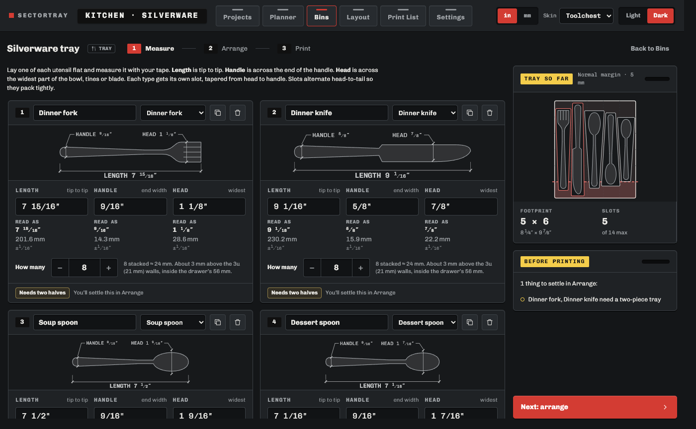
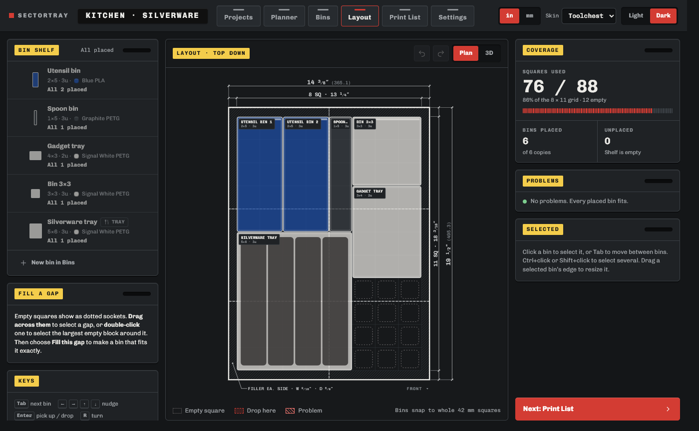
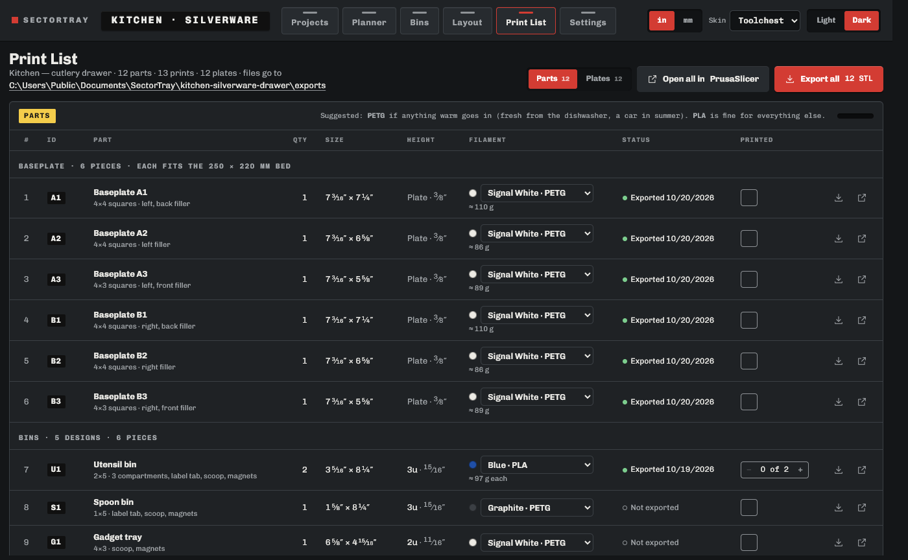

# Your first drawer

This will walk you through one drawer, from tape measure to printer. It takes about ten minutes in SectorTray; the printing takes however long it takes!

## 1. Measure the drawer

Measure the **inside** of the drawer: wall to wall, at the bottom (drawers often flare out towards the top), and the depth from the inside of the front to the inside of the back. Measure the height from the floor to where the drawer above would hit, or to the top of the sides.

Fractions are fine: `14 3/8`, `14-3/8"`, `14.375 in`, `365 mm` and `36.5 cm` all work. Rounding down by 1/16″ is safer than rounding up. SectorTray already leaves about 1 mm of clearance.

## 2. Planner: the grid and the baseplate

On **Projects**, click **New drawer**, give it a name, and type the three sizes on the **Planner**.

- When **Grid size** is set to **Standard 42 mm**, the plan shows the **grid** of 42 mm squares that fits, the **filler** (the leftover strip around the grid, printed as part of the edge pieces), and how the **baseplate** is cut into **pieces** that fit your printer. Hover a piece to see it on your printer's bed. When **Grid size** is set to **Fit to drawer**, the squares become slightly bigger or smaller so a whole number of them fills the drawer edge to edge, with no filler, and SectorTray makes the bins to match. Only bins made by SectorTray for that drawer will fit it.
- **Tallest bin** tells you how tall a bin can be and still let the drawer close based on the measurements you provided.
- **Plate style:** Standard is the everyday choice. Lite uses less plastic but has no magnet holes. Weighted has pockets underneath for weights, for a baseplate that sits loose on a desk or shelf rather than in a drawer.

## 3. Bins

On **Bins**, add bins with **New bin**. Size is in grid **squares** (2 × 3 is about 3 5/16″ × 4 15/16″) and height in **u** (one u is 7 mm; 3u is a good drawer height).

Turn on what you need: compartments, a **label tab** (a shelf along the back wall for a label), a **finger scoop**, a **stacking lip** (lets bins stack on each other; off by default though can be useful for shop drawers), and magnet holes. The 3D preview updates as you go. **How many** sets how many copies to print.

A bin bigger than your selected printer's bed will **print in pieces** that join with snap clips or bow-tie keys. The clips have been tested on a Prusa CORE One, and the bow-tie keys are still experimental: print the joint test in Settings first.

## 4. Silverware tray (optional)

**New bin → Silverware tray** opens a wizard: measure one of each utensil (length, handle width, head width) and it builds a tray with a tapered slot for each, alternating head-to-tail so they pack tightly. Trays too long for your printer print as two halves that clip together.

## 5. Layout

On **Layout**, place bins from the shelf onto the grid and drag them around. **R** turns a bin (so its label tab can face any way), **Ctrl+C / Ctrl+V** copy and paste, **Ctrl+Z** undoes. Double-click an empty area and choose **Fill this gap** to make a bin exactly that size.

The Problems panel warns about overlaps, bins hanging off the grid, and bins too tall for the drawer.

## 6. Print List

**Print List** has every part: the baseplate pieces and every bin.

- **Export all** saves the STL files (the folder link at the top opens them).
- **Open in PrusaSlicer** (or your slicer) sends one 3MF file with every part named and placed on the bed. **Plates** groups parts into bed loads, one filament per plate.
- Below the total: how many **magnets** (6 × 2 mm discs) and screws to buy.
- Tick parts and plates as you print them.

**Print one baseplate piece and one small bin first.** Check that the bin drops in and lifts out easily, and that the piece lies flat in the drawer, before printing the whole drawer. If the baseplate comes out too tight for the drawer, raise Settings → Fit → Clearance and export again.

PLA is fine for most drawers. Use PETG for anything that may hold, or become, warm (putting in silverware fresh from the dishwasher, or it sitting in a car in summer, etc.). Additionally, use a food-grade epoxy to seal it if you use it for silverware, for extra safety.

## Words used

| Word      | Means                                                                                            |
| --------- | ------------------------------------------------------------------------------------------------ |
| Square    | One 42 mm grid cell. Bins are sized in whole squares (size may differ if using "Fit to drawer"). |
| u         | Height unit: 7 mm. A 3u bin is 21 mm tall, plus 3.5 mm if it has a stacking lip.                 |
| Baseplate | The printed grid that sits in the drawer. Bins lock into it.                                     |
| Piece     | One printable part of the baseplate (a drawer's baseplate is usually several).                   |
| Filler    | Plain border around the grid that takes up the leftover space, so nothing slides.                |
| Label tab | A small shelf along the back wall of a bin for a label.                                          |
| Lip       | The stacking lip on top of a bin, so another bin can sit on it.                                  |
| Half-grid | Bin feet split into four 21 mm feet, for finer placement on some baseplates.                     |
| Plate     | One bed load of parts in the slicer.                                                             |
